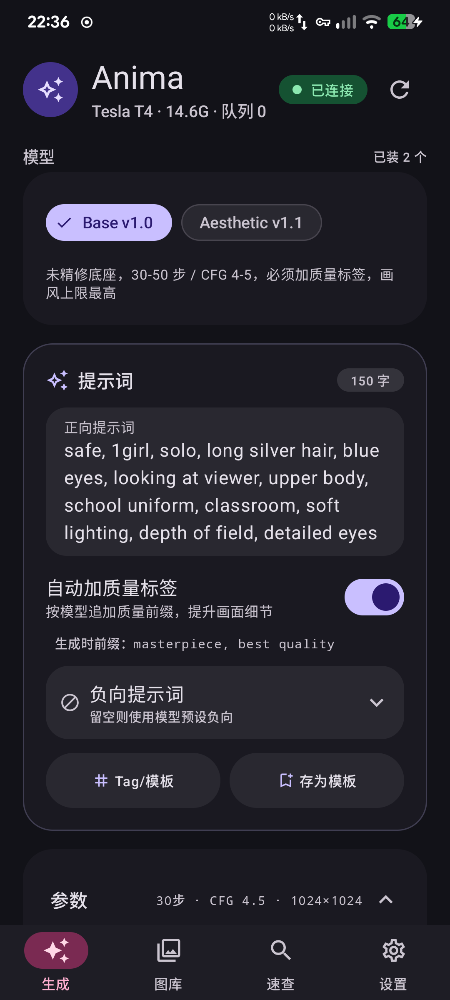
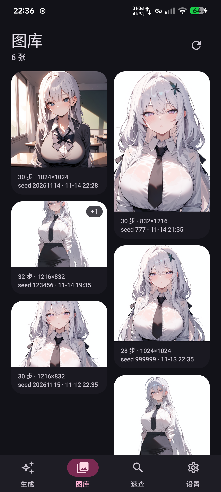
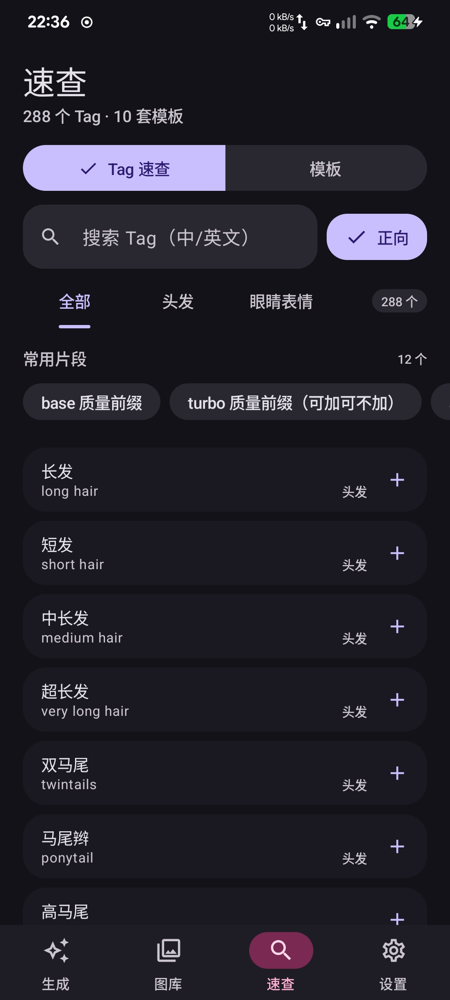
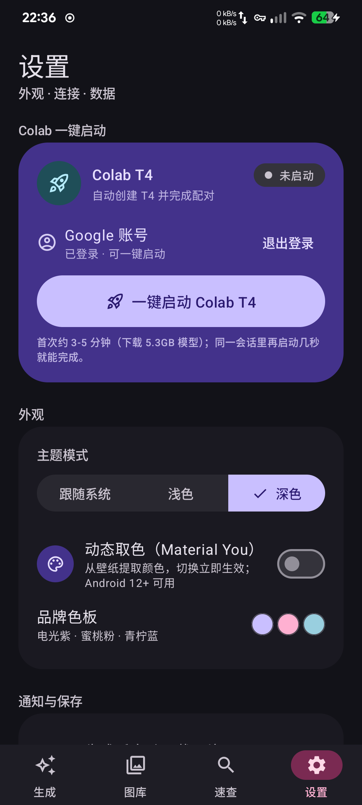
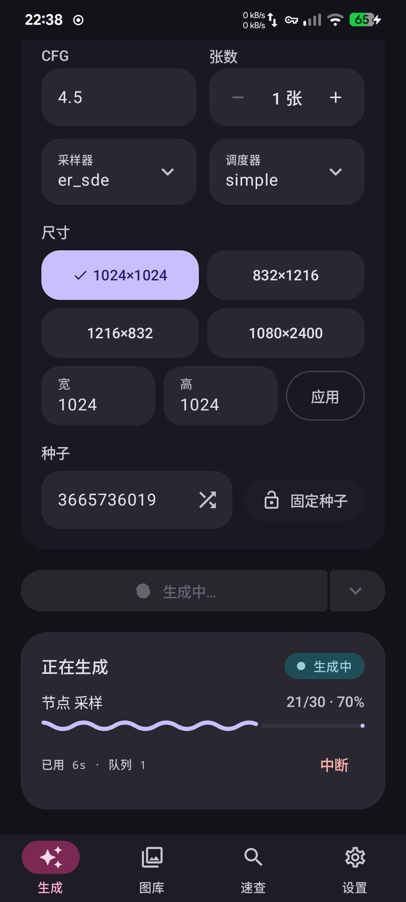
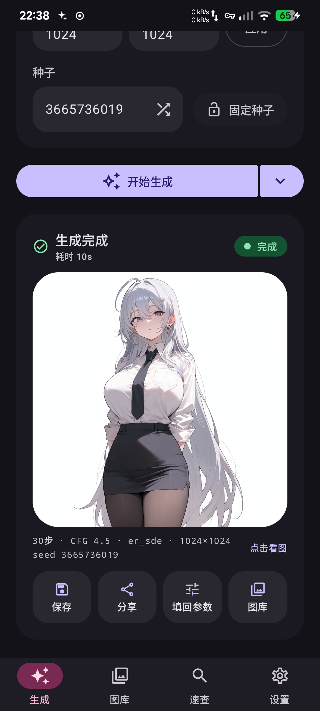
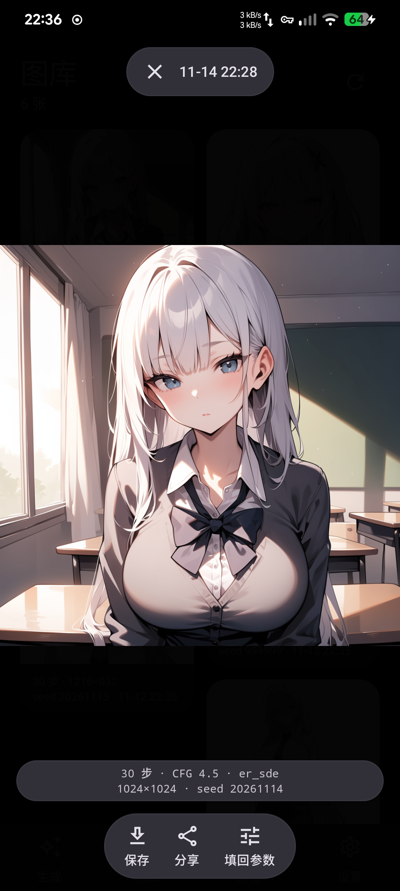
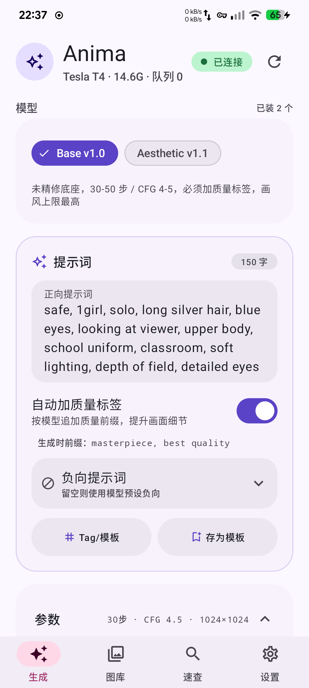

# Anima Colab → Android

手机 App（Kotlin + Jetpack Compose）通过 **Cloudflare 快速隧道 + token 鉴权** 连接 Google Colab T4 上运行的 ComfyUI，
用 **Anima（2B DiT 动漫模型）** 文生图。不搬 ComfyUI 前端，只保留手机真正需要的功能。

界面按 Google 最新设计语言 **Material 3 Expressive** 重做：深/浅色 + Material You 动态取色、
弹性物理动效、表现力排版与形状库、Expressive 组件（短导航栏、波浪进度、SplitButton、浮动工具栏）。

```
┌──────────────┐   HTTPS / WSS   ┌──────────────────┐   HTTP/WS   ┌───────────────┐
│ Android App  │ ──────────────> │ Cloudflare 快速隧道 │ ──────────> │ Colab VM       │
│ Kotlin+Compose│   Bearer token  │ (trycloudflare)   │             │ gateway:8081   │
└──────────────┘                 └──────────────────┘             │   ↓ token 校验  │
                                                                  │ ComfyUI:8188   │
                                                                  │ (仅 127.0.0.1) │
                                                                  └───────────────┘
```

## 目录

| 路径 | 内容 |
|---|---|
| `android/` | App 源码（Gradle 9.9 / AGP 9.5.1 / Kotlin 2.4.21 / Compose BOM 2026.09 / material3 1.5.0-rc01） |
| `colab/anima_colab.ipynb` | 手机「全部运行」即可的服务端笔记本（装 ComfyUI + base 模型 + 网关 + 隧道） |
| `colab/gateway.py` | token 鉴权反向代理（App 只需要它暴露的接口） |
| `colab/build_notebook.py` | 由模板生成 ipynb（改服务端代码后重新生成） |
| `docs/contract.md` | App ⇄ 网关 ⇄ ComfyUI 接口契约（开发对齐唯一依据） |
| `docs/DESIGN.md` | 重设计规范：M3 Expressive 令牌、共享组件 API、屏幕蓝图、验收清单 |
| `docs/design/m3-expressive-reference.md` | Google 最新设计标准研究：色彩/字体/形状/动效/组件 API/QA 清单 |
| `docs/device-debug.md` | 不亮屏调试 Android（scrcpy 熄屏镜像 / 无线调试 / 护 AMOLED） |
| `docs/screenshots/redesign/` | 重设计后的真机截图（深/浅色、动态取色、各页面状态） |
| `docs/colab-setup.md` | Colab 端使用与排错 |
| `scripts/build.sh` / `install.sh` | 构建 debug APK / adb 安装启动 |
| `scripts/dev.sh` / `scrcpy-off.sh` | 真机熄屏调试入口 / 独立 scrcpy 窗口 |
| `scripts/mock_gateway.py` / `device_shots.sh` | 本地 mock 网关 + 真机自动截图（视觉 QA 用，无需 Colab） |
| `scripts/extract_notebook.py` | 把 ipynb 抽成 .py 供 `colab exec` 联调 |
| `scripts/e2e_check.py` | PC 侧端到端验收（health→info→提交→出图→下载→WS） |

## 界面（Material 3 Expressive）

四个主页面：**生成 / 图库 / 速查 / 设置**，底部为 M3 Expressive 短导航栏；页面切换使用弹性位移+淡入动效。

- **生成**：Hero 状态区（一键连接 Colab）→ 提示词卡（负向可折叠、自动质量开关）→ 可折叠参数卡
  （步数/CFG/张数/采样器/尺寸/种子/LoRA）→ SplitButton 主操作（生成 + 随机种子重试/存模板）→ 波浪进度 + 结果大图。
- **图库**：服务器历史双列错落网格（按实际宽高比占位）→ 全屏查看器（多图翻页、浮动工具栏保存/分享/填回参数）。
- **速查**：Tag / 模板双模式，分类 Tab、中英文搜索、正/负向插入、常用片段、模板应用。
- **设置**：Colab 一键启动（完整状态机 + 部署日志）、**外观**（跟随系统/浅色/深色 + 动态取色开关 + 品牌色板）、
  通知与保存、手动配对、服务器信息、使用说明、关于。

| 生成 | 图库 | 速查 | 设置 |
|---|---|---|---|
|  |  |  |  |

| 生成中 | 生成结果 | 全屏查看器 | 浅色主题 |
|---|---|---|---|
|  |  |  |  |

- 动态取色（Material You）对照：[15-dynamic-color.png](docs/screenshots/redesign/15-dynamic-color.png)；空态/错误态等 15 张全量截图见 [docs/screenshots/redesign/](docs/screenshots/redesign/)。
- 设计规范 [docs/DESIGN.md](docs/DESIGN.md) · Google 最新标准研究 [docs/design/m3-expressive-reference.md](docs/design/m3-expressive-reference.md) · 真机视觉 QA 报告 [docs/design/visual-qa.md](docs/design/visual-qa.md)。

## 手机端使用流程（一键模式，推荐）

1. **登录一次**：设置页「Colab 一键启动」→ 登录 Google（浏览器授权，把授权码粘贴回来）。
2. **一键启动**：点「一键启动 Colab T4」。App 会自动：复用/申请 T4 会话 → 在 Colab kernel 里执行部署脚本
   （`assets/colab_deploy.py`，装 ComfyUI + 下载 base 模型 + 起网关 + Cloudflare 隧道）→ 解析 PAIR → 自动完成配对。
   首次 3-5 分钟，已部署过的会话几秒完成；进度和部署日志在设置页实时显示。
3. **生成**：回生成页写提示词 → 生成。App 每 4 分钟自动给 kernel 发心跳保活；不用时点「停止会话」释放。
4. **后台/通知**：会话期间前台服务常驻通知保活；出图完成自动下载到 App 本地并弹系统通知，
   点「保存」才写入系统相册（Pictures/AnimaColab）。

> 一键模式协议移植自 Google 开源的 [google-colab-cli](https://github.com/googlecolab/google-colab-cli)：
> OAuth（installed-app client + PKCE）→ `colab.research.google.com/tun/m/assign` 申请 T4 →
> `runtimeProxyInfo` → Jupyter kernel WebSocket 执行代码。手机需要能访问 Google（代理/VPN）。

## 备用：手动配对（笔记本模式）

1. **起服务端**：设置页「怎么用 → 导出备用笔记本」，把导出的 `anima_colab.ipynb` 上传 Google Drive 后用 Colab 打开 →「全部运行」。
   首次会装 ComfyUI + 下载 base 模型（约 5.3GB，3-5 分钟），跑完最后打印：
   ```
   PAIR: https://xxxx.trycloudflare.com|<token>
   ```
2. **配对**：App「设置 → 手动配对（备用）→ 粘贴配对信息」，长按粘贴整行 →「保存并连接」。
3. **生成**：写提示词 → 选参数 → 生成。base 1024² / 30 步 / CFG 4.5 在 T4 上约 70-90 秒。
4. **看图**：生成完成直接显示；「图库」里能看到服务器历史，支持保存到相册 / 分享 / 参数填回。
5. **写提示词**：「速查」页有 288 个中文分类 Danbooru tag、10 套模板、常用片段与负向预设，点一下就插入。

## 开发

```bash
scripts/build.sh            # 构建 debug APK
scripts/install.sh          # 手机连 adb 后安装并启动
scripts/build.sh release    # release（未签名）
```

视觉/交互验收（无需真实 Colab 会话，本地 mock 网关 + 真机自动截图）：

```bash
scripts/device_shots.sh --install --phase full          # 深/浅色、各页面状态截图 → docs/screenshots/redesign/
scripts/device_shots.sh --install --phase full --dim    # 同上，面板亮度压到 1（护 AMOLED，截图不受影响）
scripts/device_shots.sh --install --phase full --extras # 另拍键盘/弹窗/字体放大/横屏 → docs/screenshots/qa/
```

`--extras` 退出时会恢复面板亮度、字体缩放与旋转；横屏下速查页自动切成 compact 布局。

真机调试默认「熄屏 + 侧边栏镜像」——约定写在 [AGENTS.md](AGENTS.md)，原理与排错见
[docs/device-debug.md](docs/device-debug.md)：

```bash
scripts/dev.sh start                # 熄灭手机面板（设备保持唤醒），侧边栏/快照继续出帧
scripts/dev.sh shot .tmp/shot.jpg   # 面板熄灭也能取当前画面
scripts/dev.sh stop                 # 点亮面板，结束调试
```

需要独立 scrcpy 窗口（不经过侧边栏）时用 `scripts/scrcpy-off.sh`。

单元测试：

```bash
source scripts/env.sh && cd android && ./gradlew :app:testDebugUnitTest
```

## 服务端联调

本机没有 GPU/网络限制，服务端通过 Colab CLI 联调：

```bash
# 本机 oauth 需要代理（可选）
export HTTPS_PROXY=http://127.0.0.1:7890
colab new --gpu T4 -s anima
python3 scripts/extract_notebook.py colab/anima_colab.ipynb /tmp/anima_deploy.py
colab exec -s anima --timeout 1800 -f /tmp/anima_deploy.py
# 从笔记本输出拿 PAIR 后：
python3 scripts/e2e_check.py 'PAIR: https://...|token'
colab stop -s anima        # 用完释放
```

## 已知限制

- 免费版 Colab：约 90 分钟无操作会断（笔记本末尾 keepalive cell 维持活跃），单次会话有时长上限；
  会话结束后 `/content` 清空，模型要重新下载。
- 快速隧道 URL 每次会话都会变，需要重新粘贴 PAIR。
- T4 用 `--force-fp16`；TPU v5e1 支持留到 v2。
- Colab 平台禁止生成色情内容，只在云端跑正常内容。
